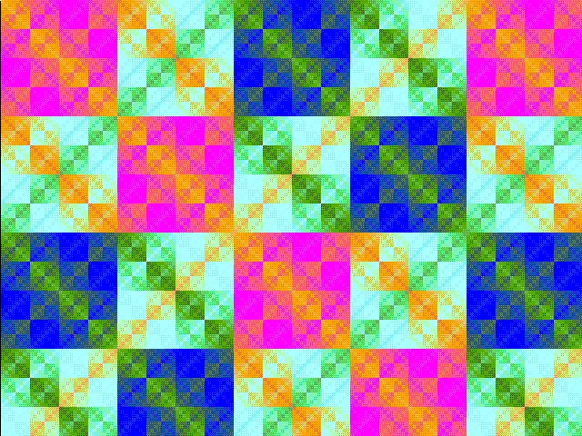
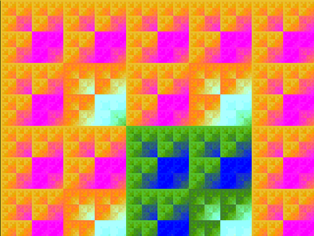
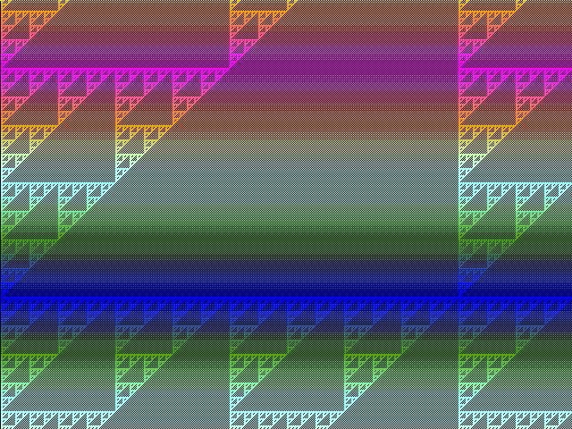

## How it works

Micro Munch is a VGA demo that fits a Tiny Tapeout **micro tile**: 70.38 x 51.68 um of sky130,
a quarter of a 1x1 tile, with only `clk`, `rst_n`, `ui_in` and `uo_out`. It uses 39 flip-flops
and about 220 gates.

It draws 640x480 at 60 Hz with 2 bits per colour. Two 10-bit counters make the timing, an
11-bit counter counts frames, and one 8-bit adder draws the picture:

    v = op(x, y) + t

where `x` and `y` are the pixel position in 2-pixel units and `t` is the frame count. `v` goes
through a palette of three triangle waves (red, green and blue, an octave apart), and a 2x2
ordered dither makes the 2 bits per colour look like 4.

`op` is one of four functions, and a mask can be laid over each, which gives eight scenes:

| Scene | op      | Picture |
|-------|---------|---------|
| 0     | x XOR y | "Munching squares" (PDP-1, 1962) in colour |
| 1     | x AND y | A Sierpinski gasket of colour steps |
| 2     | y       | A scrolling gradient |
| 3     | x OR y  | The gasket's complement |
| 4 - 7 | as 0 - 3 | The same with the mask: where `x AND v` is 0 the picture is at full brightness (a Sierpinski carpet that moves with the colours), elsewhere it is stippled to half |

The top three bits of the frame counter step through the scenes, a new one every 4.3 seconds.

## How to test

Connect a TinyVGA Pmod to the output port, set the clock to 25.175 MHz (25 MHz works on most
monitors) and reset. With all inputs low the demo steps through its eight scenes by itself.

| Input | Function |
|-------|----------|
| `ui[2:0]` | Scene offset: XORed with the automatic scene number |
| `ui[3]`   | HOLD: stop the automatic stepping, `ui[2:0]` alone selects the scene |
| `ui[4]`   | NO_DITHER: plain 2-bit colour |
| `ui[5]`   | PAUSE: freeze the animation |

The outputs are registered: `uo[7]` HSYNC and `uo[3]` VSYNC (both active low), `uo[0]`, `uo[1]`,
`uo[2]` the high bits of red, green and blue, `uo[4]`, `uo[5]`, `uo[6]` the low bits.

`test/` holds a cocotb bench that compares every clock of three frames with a cycle-exact Python
model (RTL and gate level), and `test/render` draws frames of the simulation as PNG files.

## External hardware

[TinyVGA Pmod](https://github.com/mole99/tiny-vga) on the output port and a VGA monitor.
